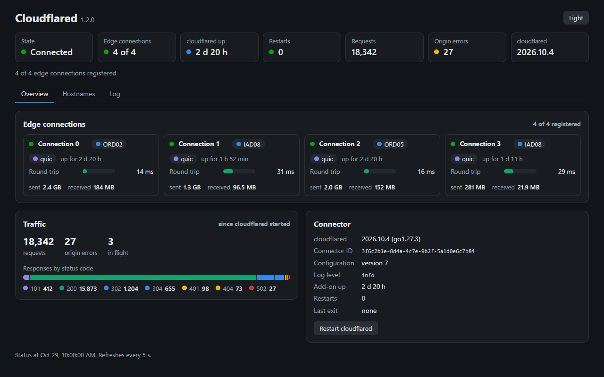
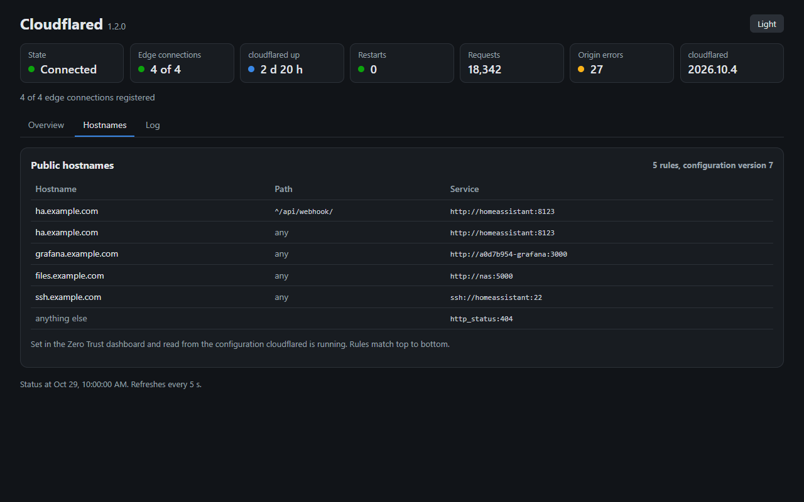
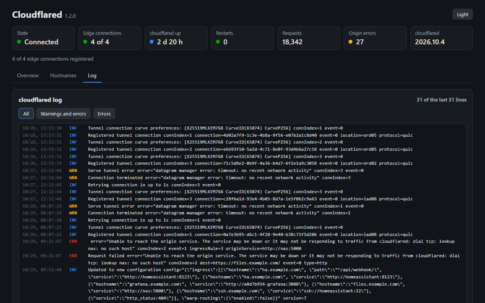

# Cloudflared Connector for Home Assistant

Home Assistant add-on repository. One add-on: the connector for a Cloudflare Tunnel configured in the Zero Trust dashboard.

Hostnames, origins and Access policies live in Cloudflare. The add-on holds only the connector token, so exposing another service needs no change here.

## Install

1. Add the repository with the first button, then open the add-on with the second and select Install.
2. In Cloudflare Zero Trust, Networks > Tunnels, create a tunnel with the Cloudflare (dashboard) option. Copy its token, or the whole install command Cloudflare shows.
3. On the add-on's Configuration tab, paste it into Tunnel token, save, and start the add-on.
4. In Zero Trust, add a public hostname to the tunnel and an Access application for it.

With no token set, the panel and the log say where in Zero Trust to find it. The tunnel is up when the Cloudflared panel shows four edge connections. Origins and troubleshooting: [DOCS.md](cloudflared_connector/DOCS.md).

## Options

| Option | Required | Default | Value |
|---|---|---|---|
| Tunnel token (`tunnel_token`) | yes | | The tunnel's token, or the install command that contains it |
| Log level (`loglevel`) | no | `info` | `debug`, `info`, `warn` or `error` |

## Panel

The add-on adds a Cloudflared page to the Home Assistant sidebar. It refreshes every 5 seconds.

| Tab | Shows |
|---|---|
| Overview | State, edge connections with location, protocol, round trip and bytes, requests and responses by status code, cloudflared version, connector ID, configuration version, restarts, a restart button |
| Hostnames | The public hostnames, paths and services the Zero Trust dashboard configured, as cloudflared is running them |
| Log | The last 300 lines cloudflared printed, filtered by level |

The screenshots show the panel's demo mode (`connector --demo`), fed with example data.

## Properties

| | |
|---|---|
| Architectures | amd64, aarch64 |
| Security rating | 8 (AppArmor profile, no host networking) |
| cloudflared | 2026.10.4, SHA-256 verified at build |
| Base image | `ghcr.io/home-assistant/base:3.24`, amd64 and arm64 |
| Process | `connector` runs cloudflared as its child, starts it again when it exits with a wait that doubles from 1 s to 60 s, and stops it with the add-on. The token reaches cloudflared only through `TUNNEL_TOKEN`. cloudflared's output reaches the add-on log unchanged. |
| Connector | Rust, built at install from `cloudflared_connector/connector/` in `rust:1.98.1-alpine3.24` |
| Panel | Ingress only; answers the Supervisor's ingress proxy and nothing else |
| Gates | `cargo fmt --check`, `cargo clippy --all-targets -- -D warnings`, `cargo nextest run`, `cargo deny check`, yamllint, hadolint, the Home Assistant add-on linter, both image builds |

## Layout

    repository.yaml              repository marker
    cloudflared_connector/       the add-on
    cloudflared_connector/connector/  the connector: supervisor, status model, panel
    docs/screenshots/            panel screenshots
    brand/                       artwork sources; generate.py derives the PNGs

Artwork in `brand/` is the maintainer's own.

## License

MIT. See [LICENSE](LICENSE).
